# Top N optimization

## Introduction

In business intelligence, it's quite common to identify top contributors to high-level metrics. **Top N** filtering addresses this need. While **Top N** filtering works quite well in Power BI **Import** mode, it can cause performance challenges and even failures when using **DirectQuery** or **Composite models**. 

In this quickstart, we explore how Top N filtering can be _optimized_ by leveraging [Native Query](https://www.databricks.com/blog/databricks-power-bi-connector-now-supports-native-query) and [Dynamic M query parameters](https://learn.microsoft.com/en-us/power-bi/connect-data/desktop-dynamic-m-query-parameters) to achieve better performance and scalability. You can follow the steps mentioned in the [Step-by-step walkthrough](#step-by-step-walkthrough) section.


## Prerequisites

Before you begin, ensure you have the following:

- [Databricks account](https://databricks.com/), access to a Databricks workspace, Unity Catalog, and Databricks SQL Warehouse
- [Power BI Desktop](https://powerbi.microsoft.com/desktop/), latest version is highly recommended


## Step-by-step walkthrough

### Preparation

#### Test dataset

1. Create a catalog in Databricks Unity Catalog.
    ```sql
    CREATE CATALOG IF NOT EXISTS powerbiquickstarts;
    USE CATALOG powerbiquickstarts;
    ```

2. Create schema **`tpch`** and tables by replicating tables from **`samples`** catalog.
    ```sql
    CREATE SCHEMA IF NOT EXISTS tpch;
    USE SCHEMA tpch;

    CREATE OR REPLACE TABLE orders AS SELECT * FROM samples.tpch.orders;
    CREATE OR REPLACE TABLE customer AS SELECT * FROM samples.tpch.customer;
    CREATE OR REPLACE TABLE nation AS SELECT * FROM samples.tpch.nation;
    CREATE OR REPLACE TABLE region AS SELECT * FROM samples.tpch.region;

    ALTER TABLE orders ADD CONSTRAINT pk_orders PRIMARY KEY(o_orderkey) RELY;
    ALTER TABLE customer ADD CONSTRAINT pk_customer PRIMARY KEY(c_custkey) RELY;
    ALTER TABLE nation ADD CONSTRAINT pk_nation PRIMARY KEY(n_nationkey) RELY;
    ALTER TABLE region ADD CONSTRAINT pk_region PRIMARY KEY(r_regionkey) RELY;

    ALTER TABLE orders ADD CONSTRAINT fk_customer FOREIGN KEY(o_custkey) REFERENCES customer NOT ENFORCED RELY;
    ALTER TABLE customer ADD CONSTRAINT fk_nation FOREIGN KEY(c_nationkey) REFERENCES nation NOT ENFORCED RELY;
    ALTER TABLE nation ADD CONSTRAINT fk_region FOREIGN KEY(n_regionkey) REFERENCES region NOT ENFORCED RELY;

    CREATE OR REPLACE VIEW v_orders AS SELECT *, now() as currenttime FROM orders;
    ```


#### Test semantic model

3. Open Power BI Desktop → **"Home"** → **"Get Data"** → **"More..."**.

4. Search for **Databricks** and select **Azure Databricks** (or **Databricks** when using Databricks on AWS or GCP).

5. Enter the following values:
   - **Server Hostname**: Enter the Server hostname value from Databricks SQL Warehouse connection details tab.
   - **HTTP Path**: Enter the HTTP path value from Databricks SQL Warehouse connection details tab.

> [!TIP]
> We recommend parameterizing your connections. This really helps ease out the Power BI development and administration experience as you can easily switch between different environments, i.e., Databricks Workspaces and SQL Warehouses. For details on how to parameterize your connection string, you can refer to [Connection Parameters](../01.%20Connection%20Parameters/) article.

6. Connect to **`powerbiquickstarts`** catalog.

7. Add tables as follows.

    | Schema | Table      | Storage Mode | Alias     |
    | ------ | ---------- | ------------ | --------- |
    | tpch   | v_orders   | DirectQuery  | orders    |
    | tpch   | customer   | Dual         | customer  |
    | tpch   | nation     | Dual         | nation    |
    | tpch   | region     | Dual         | region    |

> [!IMPORTANT]
> Here we use `v_orders` view, not `orders` table. The view uses `now()` function that prevents QRC (Query Result Caching). Therefore, for every query execution we will have non-cached query profile with execution metrics available for analysis. We do not recommend using this in production implementations as this hinders performance.

8. If relationships are not created automatically, create table relationships as follows.
   - **`region`** → **`nation`**
   - **`nation`** → **`customer`**
   - **`customer`** → **`orders`**

9. The semantic model should look as shown below.

    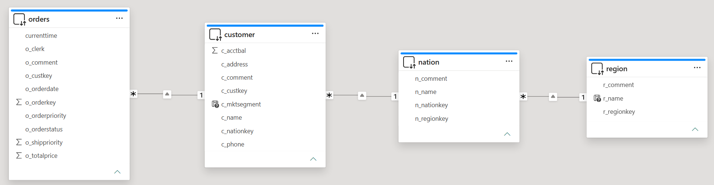


#### Test report

10. Rename the initial report page as `Overview`, and add a decomposition tree visual on the page surface.

11. Configure the decomposition tree as follows.
    - Analyze - `Sum of o_totalprice`
    - Explain by - `r_name`, `c_mktsegment`
    - Format your visual → Tree → Tree settings → Density = Sparse
 
12. In the decomposition tree, expand the root node by `r_name`. Then expand `EUROPE` node by `c_mktsegment`.

13. The report page should look as follows. The report shows the decomposition of the total price by regions and market segments.

    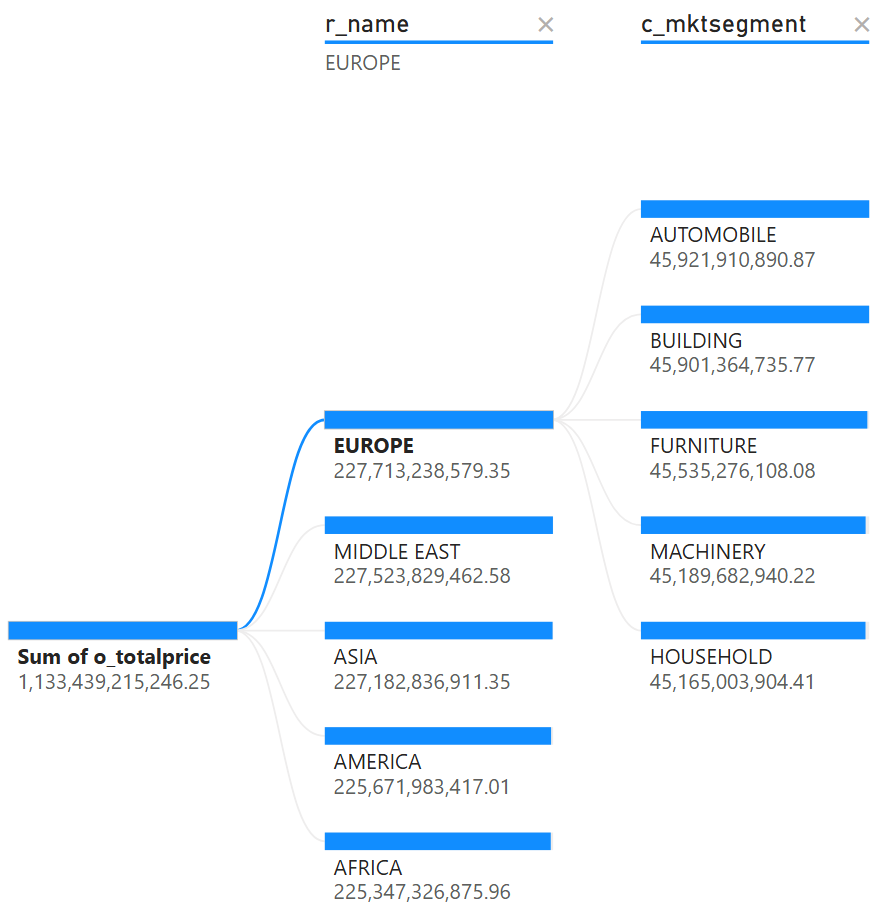


### Top N - builtin

14. To view the top 10 customers by total order amount for a given **region** and **market segment**, we use the [Drillthrough](https://learn.microsoft.com/en-us/power-bi/create-reports/desktop-drillthrough) capability in Power BI.

15. Create a new report page - `TopN v1`.

16. Add the following columns to `Add drill-through fields here` configuration of the report page.
    - `r_name`
    - `c_mktsegment`
    
        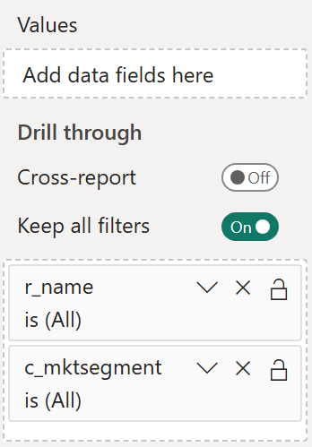

17. Assign arbitrary filter values for these columns. E.g. `EUROPE` and `AUTOMOBILE`.
 
    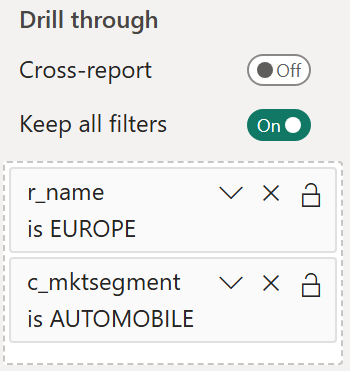

18. Add a table visual to the report page. Add the following columns to the table visual.
    - `r_name`
    - `c_mktsegment`
    - `c_name`
    - `Sum of o_totalprice`

19. Configure a filter on the table visual as follows.
    - column - `c_name`
    - Filter type - `Top N`
    - Show items - `Top 10`
    - By value - `Sum of o_totalprice`
        
        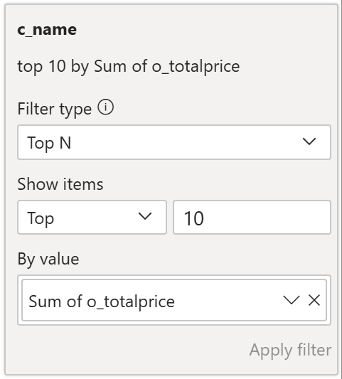

20. Now, on the `Overview` report page in the decomposition tree, we can drill through to the detailed page to see top 10 customers for the selected region and market segment.

    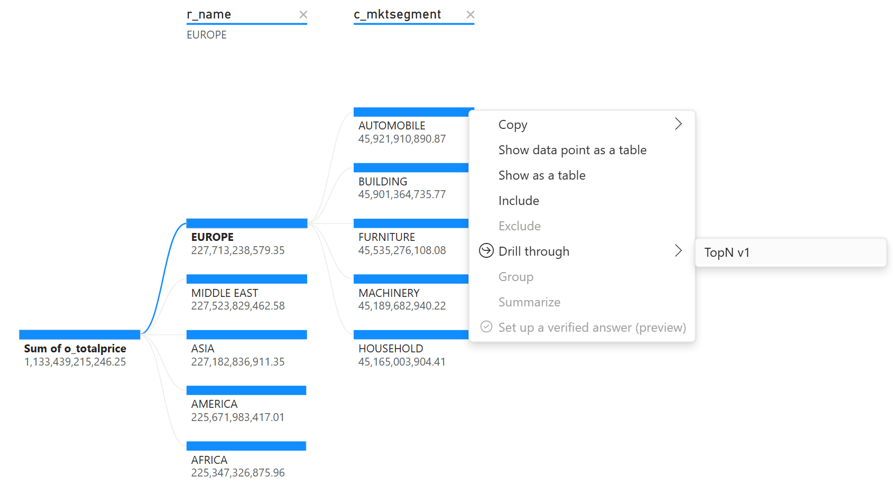

21. Click `TopN v1` to drill through. The page `TopN v1` shows **top 10** customers in **EUROPE** for **AUTOMOBILE** market segment.

    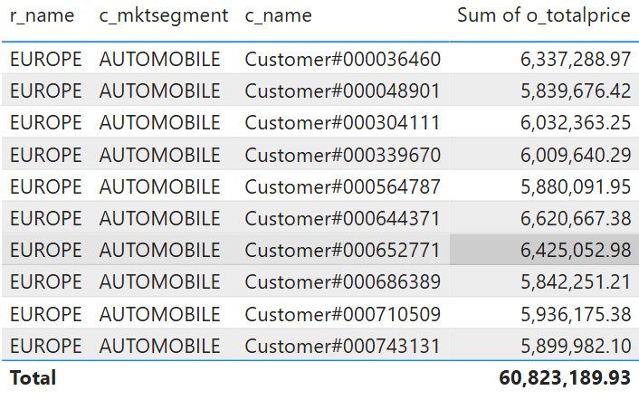

22. Now, let's explore Databricks query history. Power BI executed 2 queries to retrieve the top 10 customers in **EUROPE** for **AUTOMOBILE** market segment.
    <details>
    <summary>TopN v1 - query #1</summary>
    ```sql
    select
    `c_name`,
    `C1`
    from
    (
        select
        `c_name`,
        SUM(`o_totalprice`) as `C1`
        from
        (
            select
            `OTBL`.`o_totalprice`,
            `OTBL`.`c_name`
            from
            (
                select
                `OTBL`.`o_orderkey`,
                `OTBL`.`o_custkey`,
                `OTBL`.`o_orderstatus`,
                `OTBL`.`o_totalprice`,
                `OTBL`.`o_orderdate`,
                `OTBL`.`o_orderpriority`,
                `OTBL`.`o_clerk`,
                `OTBL`.`o_shippriority`,
                `OTBL`.`o_comment`,
                `OTBL`.`currenttime`,
                `OTBL`.`c_custkey`,
                `OTBL`.`c_name`,
                `OTBL`.`c_address`,
                `OTBL`.`c_nationkey`,
                `OTBL`.`c_phone`,
                `OTBL`.`c_acctbal`,
                `OTBL`.`c_mktsegment`,
                `OTBL`.`c_comment`,
                `ITBL`.`n_nationkey`,
                `ITBL`.`n_name`,
                `ITBL`.`n_regionkey`,
                `ITBL`.`n_comment`
                from
                (
                    select
                    `OTBL`.`o_orderkey`,
                    `OTBL`.`o_custkey`,
                    `OTBL`.`o_orderstatus`,
                    `OTBL`.`o_totalprice`,
                    `OTBL`.`o_orderdate`,
                    `OTBL`.`o_orderpriority`,
                    `OTBL`.`o_clerk`,
                    `OTBL`.`o_shippriority`,
                    `OTBL`.`o_comment`,
                    `OTBL`.`currenttime`,
                    `ITBL`.`c_custkey`,
                    `ITBL`.`c_name`,
                    `ITBL`.`c_address`,
                    `ITBL`.`c_nationkey`,
                    `ITBL`.`c_phone`,
                    `ITBL`.`c_acctbal`,
                    `ITBL`.`c_mktsegment`,
                    `ITBL`.`c_comment`
                    from
                    `powerbiquickstarts`.`tpch`.`v_orders` as `OTBL`
                        left outer join `powerbiquickstarts`.`tpch`.`customer` as `ITBL`
                        on (`OTBL`.`o_custkey` = `ITBL`.`c_custkey`)
                    where
                    `ITBL`.`c_mktsegment` = 'AUTOMOBILE'
                ) as `OTBL`
                    left outer join `powerbiquickstarts`.`tpch`.`nation` as `ITBL`
                    on (`OTBL`.`c_nationkey` = `ITBL`.`n_nationkey`)
            ) as `OTBL`
                left outer join `powerbiquickstarts`.`tpch`.`region` as `ITBL`
                on (`OTBL`.`n_regionkey` = `ITBL`.`r_regionkey`)
            where
            `ITBL`.`r_name` = 'EUROPE'
        ) as `ITBL`
        group by
        `c_name`
    ) as `ITBL`
    where
    not `C1` is null
    limit 1000001
    ```
    </details>

    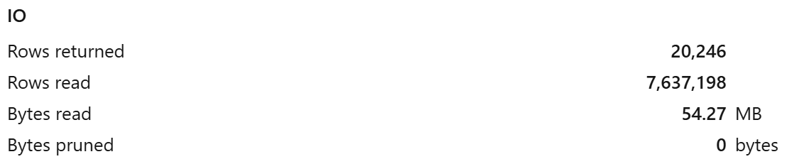

    <details>
    <summary>TopN v1 - query #2</summary>
    ```sql
    select
    `c_name`,
    `C1`
    from
    (
        select
        `c_name`,
        SUM(`o_totalprice`) as `C1`
        from
        (
            select
            `OTBL`.`o_totalprice`,
            `OTBL`.`c_name`
            from
            (
                select
                `OTBL`.`o_orderkey`,
                `OTBL`.`o_custkey`,
                `OTBL`.`o_orderstatus`,
                `OTBL`.`o_totalprice`,
                `OTBL`.`o_orderdate`,
                `OTBL`.`o_orderpriority`,
                `OTBL`.`o_clerk`,
                `OTBL`.`o_shippriority`,
                `OTBL`.`o_comment`,
                `OTBL`.`currenttime`,
                `OTBL`.`c_custkey`,
                `OTBL`.`c_name`,
                `OTBL`.`c_address`,
                `OTBL`.`c_nationkey`,
                `OTBL`.`c_phone`,
                `OTBL`.`c_acctbal`,
                `OTBL`.`c_mktsegment`,
                `OTBL`.`c_comment`,
                `ITBL`.`n_nationkey`,
                `ITBL`.`n_name`,
                `ITBL`.`n_regionkey`,
                `ITBL`.`n_comment`
                from
                (
                    select
                    `OTBL`.`o_orderkey`,
                    `OTBL`.`o_custkey`,
                    `OTBL`.`o_orderstatus`,
                    `OTBL`.`o_totalprice`,
                    `OTBL`.`o_orderdate`,
                    `OTBL`.`o_orderpriority`,
                    `OTBL`.`o_clerk`,
                    `OTBL`.`o_shippriority`,
                    `OTBL`.`o_comment`,
                    `OTBL`.`currenttime`,
                    `ITBL`.`c_custkey`,
                    `ITBL`.`c_name`,
                    `ITBL`.`c_address`,
                    `ITBL`.`c_nationkey`,
                    `ITBL`.`c_phone`,
                    `ITBL`.`c_acctbal`,
                    `ITBL`.`c_mktsegment`,
                    `ITBL`.`c_comment`
                    from
                    `powerbiquickstarts`.`tpch`.`v_orders` as `OTBL`
                        left outer join `powerbiquickstarts`.`tpch`.`customer` as `ITBL`
                        on (`OTBL`.`o_custkey` = `ITBL`.`c_custkey`)
                    where
                    `ITBL`.`c_mktsegment` = 'AUTOMOBILE'
                ) as `OTBL`
                    left outer join `powerbiquickstarts`.`tpch`.`nation` as `ITBL`
                    on (`OTBL`.`c_nationkey` = `ITBL`.`n_nationkey`)
            ) as `OTBL`
                left outer join `powerbiquickstarts`.`tpch`.`region` as `ITBL`
                on (`OTBL`.`n_regionkey` = `ITBL`.`r_regionkey`)
            where
            `ITBL`.`r_name` = 'EUROPE'
            and (
                `OTBL`.`c_name` in (
                'Customer#000644371',
                'Customer#000652771',
                'Customer#000564787',
                'Customer#000339670',
                'Customer#000710509',
                'Customer#000048901',
                'Customer#000743131',
                'Customer#000036460',
                'Customer#000304111',
                'Customer#000686389'
                )
            )
        ) as `ITBL`
        group by
        `c_name`
    ) as `ITBL`
    where
    not `C1` is null
    limit 1000001
    ```
    </details>

    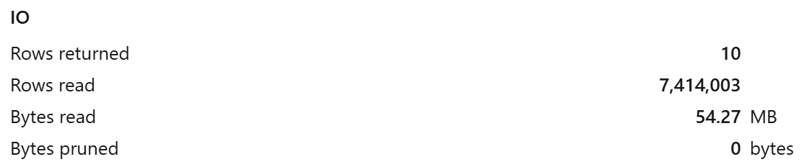


23. There are 2 SQL queries. The first query retrieves all records in **EUROPE** for **AUTOMOBILE** market segment, i.e., 20,246 records. The second query retrieves data for 10 specific customers.
This means that Power BI performs top N filtering _on the client side_. While this approach may work fine for smaller data volumes, it becomes inefficient and slow for larger data volumes. Ultimately, Power BI may hit [Million-row limit](https://learn.microsoft.com/en-us/power-bi/connect-data/desktop-use-directquery#million-row-limit), so that the report would fail.


### Top N - using M code

While Power BI does not generate proper **Top N** queries, modern SQL engines, including [Databricks SQL](https://learn.microsoft.com/en-us/azure/databricks/compute/sql-warehouse/) and [Lakehouse//RT](https://learn.microsoft.com/en-us/azure/databricks/compute/sql-warehouse/real-time), are very efficient with such queries. In this section, we will discuss how to leverage the power of Databricks SQL to retrieve top 10 customers more efficiently.
The approach is based on [Dynamic M query parameters](../06.%20Dynamic%20M%20Query%20Parameters/).

24. **"Transform data"** → **"Manage Parameters"**.

25. Create parameter `RegionName` as shown below.

    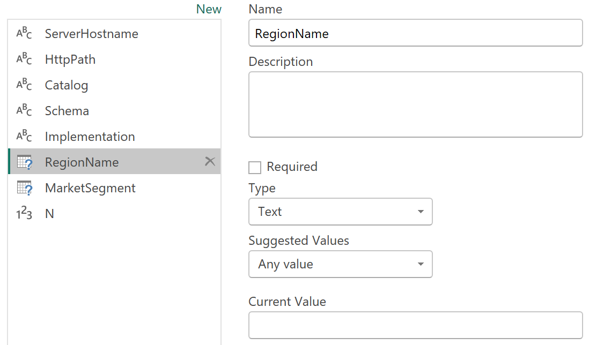

26. Create parameter `MarketSegment` as shown below.

    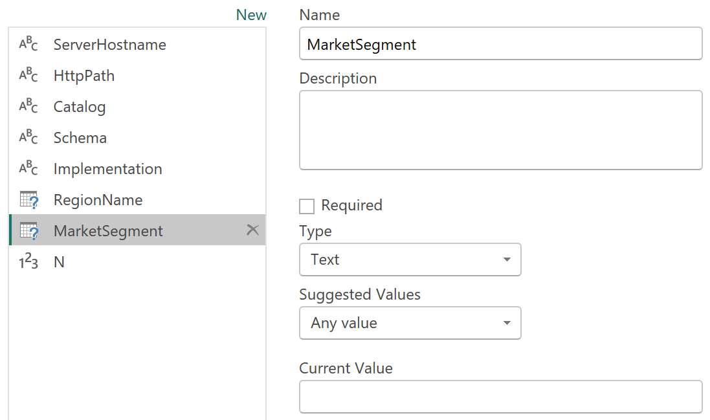

27. Create parameter `N` as shown below. `N` is fixed at 10, implementing `Top 10` filtering. Adjust it if needed.

    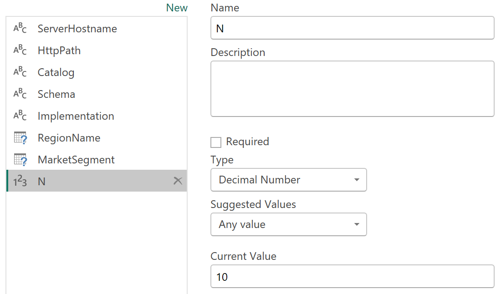

28. Duplicate any existing table, e.g., `orders`. Select the new table, name it `topN_customers`. Click **Advanced Editor**.

29. Replace the code for the new table using the following.

> [!NOTE]
> The code below uses `ServerHostname`, `HttpPath`, `Catalog` and `Schema` parameters. If you don't use these parameters, replace them in the code with actual values. 

    ```
    let
        selectedMarketSegment = if Type.Is(Value.Type(MarketSegment), List.Type) then
            Text.Combine({"'", Text.Combine(MarketSegment, "','"), "'"})
        else
            Text.Combine({"'", MarketSegment, "'"}),
        
        selectedRegion = if Type.Is(Value.Type(RegionName), List.Type) then
            Text.Combine({"'", Text.Combine(RegionName, "','"), "'"})
        else
            Text.Combine({"'", RegionName, "'"}),

        topN_customers = Value.NativeQuery(Databricks.Catalogs(ServerHostname, HttpPath, 
            [Implementation=Implementation, Catalog=Catalog, Database=null, EnableAutomaticProxyDiscovery=EnableAutomaticProxyDiscovery]){[Name=Catalog,Kind="Database"]}[Data],
            "SELECT c_name, r_name, c_mktsegment, sum(o_totalprice) as TotalPrice,
                rank() OVER(ORDER BY sum(o_totalprice) DESC) rnk,
                now() as ts
            FROM " & Schema & ".customer 
                join " & Schema & ".v_orders on c_custkey = o_custkey
                join " & Schema & ".nation on c_nationkey = n_nationkey
                join " & Schema & ".region on n_regionkey = r_regionkey
            WHERE 1=1
                " & (if MarketSegment<>null then "and c_mktsegment IN (" & selectedMarketSegment & ")" else "") & "
                " & (if RegionName<>null then "and r_name IN (" & selectedRegion & ")" else "") & "
            GROUP BY ALL
            QUALIFY rnk <= " & Number.ToText(N),
        null, [EnableFolding=true])
    in
        topN_customers
    ```

30. When executing this code, Power BI constructs the SQL `WHERE` clause using the `RegionName` and `MarketSegment` parameters. The `N` parameter limits returned rows through `QUALIFY`. `N` has a default value of 10. This implements `Top 10` logic.

31. Click **Done** to save changes to the table. Make sure that the table is successfully refreshed. By default, it should contain top 10 customers without filters.

32. Click **Close & Apply** to save changes.

33. Now, we need to map the parameters that we created to tables. Switch to **Model view**.

34. Select `region` table, `r_name` column. Set **Bind to parameter** to `RegionName`.

    

35. Select `customer` table, `c_mktsegment` column. Set **Bind to parameter** to `MarketSegment`.

    

36. Duplicate `TopN v1` report page. Rename the new page as `TopN v2`.

37. In the table visual on `TopN v2` page, remove the `Top N` filter on `c_name` column.

    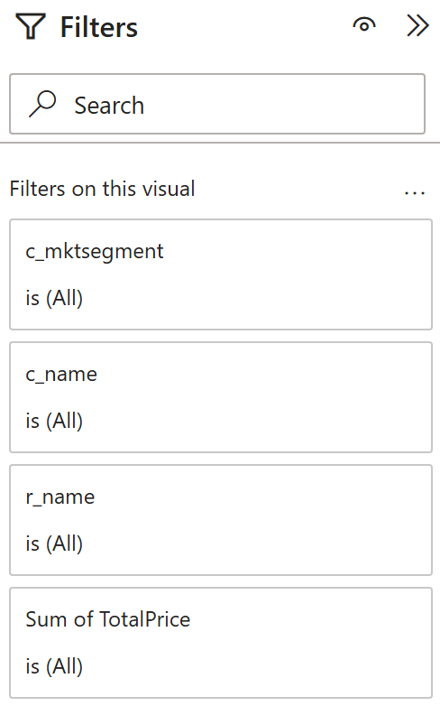

38. In the table visual on `TopN v2` page, replace columns as follows.

    | Old table   | Old column            | New table         | New column     |
    | ----------- | --------------------- | ----------------- | -------------- |
    | `region`    | `r_name`              | `topN_customers`  | `r_name`       |
    | `customer`  | `c_mktsegment`        | `topN_customers`  | `c_mktsegment` |
    | `customer`  | `c_name`              | `topN_customers`  | `c_name`       |
    | `orders`    | `Sum of o_totalprice` | `topN_customers`  | `TotalPrice`   |

39. Now, on the `Overview` report page in the decomposition tree, we can drill through using `TopN v2` page to see top 10 customers for the selected region and market segment.

    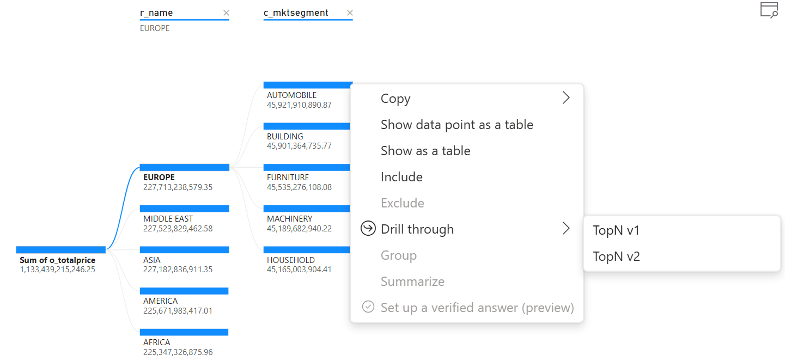

40. Click `TopN v2` to drill through. The page `TopN v2` shows **top 10** customers in **EUROPE** for **AUTOMOBILE** market segment. The result looks the same as previously.

    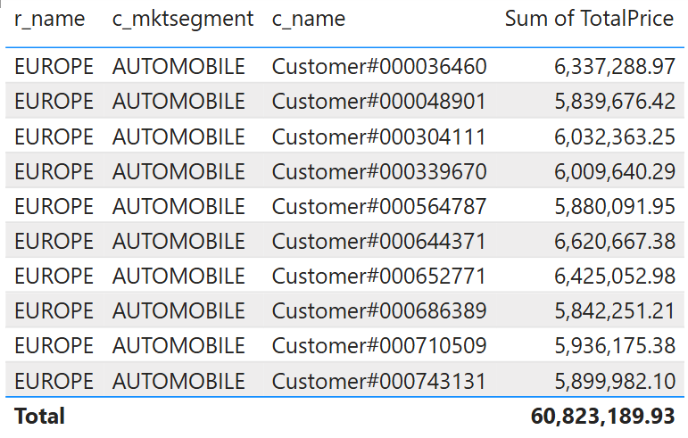

41. Now, let's explore Databricks query history. We can find the following query executed by Power BI to retrieve the top 10 customers in **EUROPE** for **AUTOMOBILE** market segment.

    <details>
    <summary>TopN v2 - query #1</summary>
    ```sql
    select
    *
    from
    (
        SELECT
        c_name,
        r_name,
        c_mktsegment,
        sum(o_totalprice) as TotalPrice,
        rank() OVER (ORDER BY sum(o_totalprice) DESC) rnk,
        now() as ts
        FROM
        tpch.customer
            join tpch.v_orders
            on c_custkey = o_custkey
            join tpch.nation
            on c_nationkey = n_nationkey
            join tpch.region
            on n_regionkey = r_regionkey
        WHERE
        1 = 1
        and c_mktsegment IN ('AUTOMOBILE')
        and r_name IN ('EUROPE')
        GROUP BY
        ALL
        QUALIFY
        rnk <= 10
    ) as `_`
    where
    0 = 1 
    ```
    </details>
    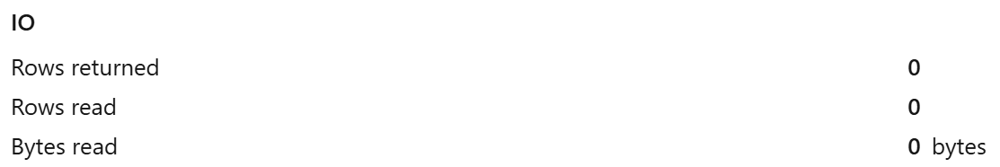

    <details>
    <summary>TopN v2 - query #2</summary>
    ```sql
    select
    `c_name`,
    `c_mktsegment`,
    `r_name`,
    `C1`
    from
    (
        select
        `c_name`,
        `c_mktsegment`,
        `r_name`,
        SUM(`TotalPrice`) as `C1`
        from
        (
            SELECT
            c_name,
            r_name,
            c_mktsegment,
            sum(o_totalprice) as TotalPrice,
            rank() OVER (ORDER BY sum(o_totalprice) DESC) rnk,
            now() as ts
            FROM
            tpch.customer
                join tpch.v_orders
                on c_custkey = o_custkey
                join tpch.nation
                on c_nationkey = n_nationkey
                join tpch.region
                on n_regionkey = r_regionkey
            WHERE
            1 = 1
            and c_mktsegment IN ('AUTOMOBILE')
            and r_name IN ('EUROPE')
            GROUP BY
            ALL
            QUALIFY
            rnk <= 10
        ) as `_`
        group by
        `c_name`,
        `c_mktsegment`,
        `r_name`
    ) as `ITBL`
    where
    not `C1` is null
    limit 1000001
    ```
    </details>

    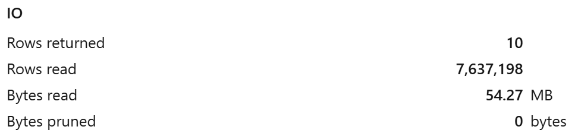

42. There are 2 SQL queries. Both queries are based on the query that is constructed in M code of the `topN_customers` table that we defined earlier. The first query uses `where 0=1` clause to retrieve the metadata of the result set only. The second query retrieves actual **top 10** customers. This difference from the builtin approach improves performance and scalability.


### Conclusion

In the builtin approach, we observed that Power BI generates 2 queries, where the first one is quite expensive. It may cause performance challenges and even failures if the total number of records in scope exceeds 1M. In the second approach, we leverage [Native Query](https://www.databricks.com/blog/databricks-power-bi-connector-now-supports-native-query) and [Dynamic M query parameters](https://learn.microsoft.com/en-us/power-bi/connect-data/desktop-dynamic-m-query-parameters). This causes Power BI to generate a more efficient SQL query that performs more efficiently and helps avoid exceeding the [million-row limit](https://learn.microsoft.com/en-us/power-bi/connect-data/desktop-use-directquery#million-row-limit).

> [!CAUTION]
> Though the approach discussed in this article is more efficient, it is less flexible than builtin Top N filtering, and it has certain limitations. For example, limited hierarchy support and increased complexity when supporting sophisticated calculation contexts.

This approach can help implement much more efficient and performant reports when using DirectQuery or Composite models. However, we recommend thorough testing to understand possible limitations and caveats.


## Power BI template 

A Power BI template [Top N optimization.pbit](./Top%20N%20optimization.pbit) and [Top N optimization.sql](./Top%20N%20optimization.sql) script are provided in this folder to demonstrate the approach discussed in this article. To use the template, simply enter your Databricks SQL Warehouse's **`ServerHostname`** and **`HttpPath`**, along with the **`Catalog`**, and **`Schema`** names that correspond to the environment set up in the instructions above.